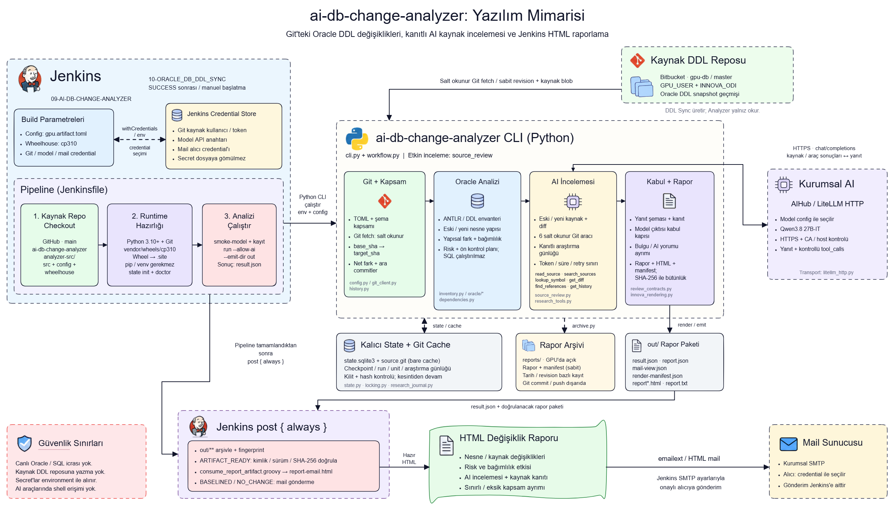

# AI Database Change Analyzer

Oracle DDL snapshot’larının iki sabit Git revision’ı arasındaki farklarını
inceleyen, sonucu kaynak kanıtlarıyla birlikte raporlayan Python 3.10+ CLI
ürünüdür. Analyzer yalnızca Git’teki kaynakları okur; canlı Oracle’a bağlanmaz,
SQL çalıştırmaz ve kaynak DDL repository’sine yazmaz.

## Arka plan ve amaç

Bu proje, `10-ORACLE_DB_DDL_SYNC` job’ının ürettiği `gpu-db` snapshot’larını
karşılaştırarak dağıtıma hazırlanan veritabanı değişikliklerini görünür hale
getirir. Amaç yalnızca dosya farkı üretmek değil; değişikliğin nesne türünü,
önceliğini, riskini ve rapora yansıtılabilecek kanıt sınırlarını anlaşılır bir
şekilde göstermektir.

Analyzer mevcut DB Sync pipeline’ına stage eklemez ve onun davranışını
değiştirmez. Jenkins’te ayrı bir downstream job olarak çalışır; doğrulanmış
artifact’leri arşivler ve hazırlanmış HTML raporunu standart Jenkins mail akışı
üzerinden gönderir.

## Mimari



Diyagramın düzenlenebilir kaynakları:
[`docs/architecture.excalidraw`](docs/architecture.excalidraw) ve
[`docs/architecture.json`](docs/architecture.json). JSON dosyasını
[Excalidraw](https://excalidraw.com/) üzerinde açabilirsiniz.

Temel akış şöyledir:

1. Jenkins, upstream DB Sync job’ının tamamlanmasını bekler.
2. Analyzer `gpu-db` Git geçmişinden iki revision arasındaki aralığı belirler.
3. Deterministik karşılaştırma nesne türü, değişiklik durumu, öncelik, risk ve
   sequence gruplamasını üretir.
4. Uygun kapsamda model değerlendirmesi yapılır; ham SQL modele gönderilmez.
5. HTML, text ve JSON artifact’leri doğrulanır, arşivlenir ve mail gönderimine
   hazırlanır.

## Analiz kapsamı

### Deterministik karşılaştırma

Rapor; dosya kapsamını ve çözümlenen nesne sayısını birbirinden ayırarak
gösterir. Nesneler için aşağıdaki bilgiler üretilir:

- tablo, index, sequence, view, package, trigger, procedure, function ve type
  gibi Oracle nesne türleri,
- eklenen, güncellenen veya silinen değişiklik durumu,
- nesne türüne göre öncelik ve risk sınıflandırması,
- sequence değişikliklerinin tek satırlık özet halinde gruplanması,
- doğrulanmış kaynak farkları ve ayrıştırılamayan alanların kapsam bilgisi.

### Model değerlendirmesi

Model kullanımı güvenli bir eşikle sınırlandırılmıştır:

- 10 veya daha az değişen nesnede nesne bazlı AI incelemesi yapılır.
- 10 nesneden fazla olduğunda nesne bazlı çağrılar yapılmaz; yalnızca tek bir
  toplu model değerlendirmesi çalıştırılır.
- Toplu çağrıya ham SQL, canlı sistem iddiası veya araştırma aracı verilmez.
- Toplu değerlendirme raporda yalnızca **Etki ve Değerlendirme** bölümünde
  gösterilir.
- Model timeout veya geçersiz yanıt verirse deterministik rapor üretilebilir
  kalır ve AI bölümü sınırlı olarak işaretlenir.

Bu sınır `analysis.max_objects_for_individual_ai_review` ayarıyla açıkça
tanımlıdır. Kullanıcıya gösterilen model etiketi `Qwen3.8 27B-IT`, teknik
endpoint route’u ise yalnızca çalışma config’inde tutulur.

## Jenkins kullanımı

Repository’deki `Jenkinsfile`, `10-ORACLE_DB_DDL_SYNC` job’ının başarılı
tamamlanmasından sonra çalışacak artifact pipeline’ını tanımlar. Pipeline:

- yalnız `gpu-db` Git geçmişini okur,
- canlı Oracle’a bağlanmaz,
- doğrulanmış artifact’leri Jenkins’e arşivletir,
- doğrulanmış `report-email.html` dosyasını standart `emailext` adımıyla
  gönderir,
- `BASELINED` ve `NO_CHANGE` sonuçlarında mail göndermez.

Job, upstream tetikleyicisinin yanında Jenkins’te **Build with Parameters** ile
manuel olarak da çalıştırılabilir. İki SHA birlikte verilirse otomatik
checkpoint değiştirilmeden kontrollü manuel analiz yapılır.

### Jenkins parametreleri

| Parametre | Kullanım |
|---|---|
| `ANALYZER_CONFIG` | Analyzer checkout’undaki çalışma profili; varsayılan `config/gpu.artifact.toml` |
| `ANALYZER_WHEELHOUSE` | Onaylı ve hash kilitli Python wheel klasörü |
| `ANALYZER_MANUAL_BASE_SHA` | Manuel analiz aralığının başlangıç revision’ı |
| `ANALYZER_MANUAL_TARGET_SHA` | Manuel analiz aralığının hedef revision’ı |
| `ANALYZER_MAIL_CREDENTIAL_ID` | Mail alıcı listesini taşıyan Jenkins Secret Text credential ID’si |
| `ANALYZER_GIT_CREDENTIAL_ID` | `gpu-db` Git erişimi için Jenkins credential ID’si |
| `ANALYZER_MODEL_KEY_CREDENTIAL_ID` | Kurumsal model endpoint anahtarı için Jenkins credential ID’si |

Varsayılan mail credential ID’si `gpu-oracle-ddl-sync-notify-to`’dur. Alıcı
adresleri kaynak koda veya README’ye yazılmaz; Jenkins Credentials üzerinden
yönetilir.

### Jenkins çalışma sınırları

Analyzer ayrılmış `jenkins-2` agent’ında çalışır, aynı anda ikinci bir build’in
başlamasını engeller ve 30 dakikalık job timeout’una sahiptir. Kaynak kod,
config ve Python wheelhouse doğrudan repository checkout’undan okunur; Jenkins
agent’ta pip, venv veya internet erişimi gerekmez.

## Rapor çıktıları

Başarılı bir analizde `out/` altında doğrulanan başlıca dosyalar şunlardır:

| Dosya | Amaç |
|---|---|
| `report-email.html` | Mailde gönderilen responsive HTML rapor |
| `report.html` | Tarayıcıda incelenen HTML rapor |
| `report.txt` | Sade metin raporu |
| `report.json` | Canonical analiz kaydı |
| `result.json` | Çalışma ve teslimat sonucu |
| `mail-view.json` | Mail görünümü için doğrulanmış yan kayıt |
| `render-manifest.json` | Render ve artifact bütünlüğü kaydı |

HTML raporunda toplam değişiklik, risk seviyesi ve analiz bilgileri üstte; özet,
etki/değerlendirme, değişiklik detayları ve izlenebilirlik bölümleri önem sırasına
göre yer alır. Responsive düzen masaüstü ve mobil mail istemcileri için
uygundur.

## Yerel geliştirme

### Kurulum

```text
python3 -m venv .venv
.venv/bin/python -m pip install --require-hashes -r requirements-dev.lock
PYTHONPATH=src .venv/bin/python -m db_change_analyzer --config config/gpu.example.toml doctor --offline
```

Örnek config canlı model capability doğrulamasını kapalı ve SMTP alanlarını
placeholder olarak bırakır. Gerçek credential dosyaya yazılmaz; çalışma zamanı
değerleri yalnızca onaylı environment veya Jenkins credential akışından alınır.

### Temel offline akış

```text
db-change-analyzer --config gpu.toml state init --confirm-new-install
db-change-analyzer --config gpu.toml doctor --offline
db-change-analyzer --config gpu.toml inventory --target <FULL_SHA> --offline
db-change-analyzer --config gpu.toml run --dry-run --offline
```

`run --allow-ai --allow-mail` yalnızca doğrulanmış model profili ve hazırlanmış
SMTP config ile açılır. `manual` otomatik checkpoint’i değiştirmez;
`notification resend` yeni AI analizi çalıştırmaz.

## Testler ve kalite kontrolleri

Tam test paketi:

```text
PYTHONPATH=src .venv/bin/python -m pytest -q
```

Sözleşme, release manifest ve final audit kontrolleri:

```text
python tools/check_contracts.py
python tools/check_release_manifest.py
python tools/final_audit.py %TEMP%\\ai-db-change-analyzer-final-audit.json
```

Source-review değerlendirmesi aynı sentetik corpus üzerinde mock
sözleşme/rubrik koşusuyla yapılır; mock sonuç gerçek model kalite kabulü
değildir. İnsan değerlendirme alanları
`docs/GERCEK_MODEL_DEGERLENDIRME_FORMU.md` içinde tutulur.

## Güvenlik ve sınırlamalar

- Analyzer canlı Oracle bağlantısı kurmaz ve SQL çalıştırmaz.
- Model girdisi kanıtlanmış, temizlenmiş analiz verisinden oluşur; ham SQL ve
  gizli credential değerleri gönderilmez.
- AI değerlendirmesi başarısız olsa bile deterministik bulgular korunur.
- Statik bağımlılıklar, nesne bazlı risk rozetleri ve çalıştırılmamış deployment
  ön kontrol planı rapora yazılabilir; bu bilgiler canlı sistemde doğrulama
  yapıldığı anlamına gelmez.
- Arşiv özelliği isteğe bağlıdır. `reports.archive_enabled = true` ve
  `reports.archive_root` ile açılır; raporlar uygulama checkout’unda immutable
  kayıt olarak tutulur.

Ayrıntılı güvenlik ve işletim bilgileri için:

- [`docs/GUVENLIK_KALITE_DENETIMI.md`](docs/GUVENLIK_KALITE_DENETIMI.md)
- [`docs/CORPUS_DOGRULAMA.md`](docs/CORPUS_DOGRULAMA.md)
- [`docs/OPERASYON.md`](docs/OPERASYON.md)
- [`docs/DB_CHANGE_ANALYZER_KAPSAM.md`](docs/DB_CHANGE_ANALYZER_KAPSAM.md)
